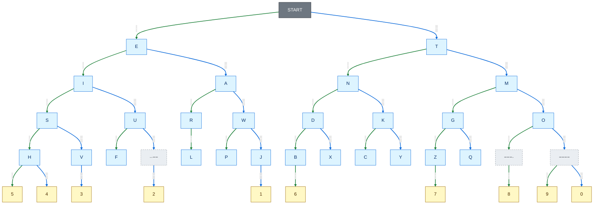
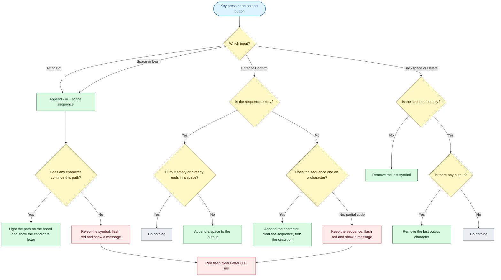
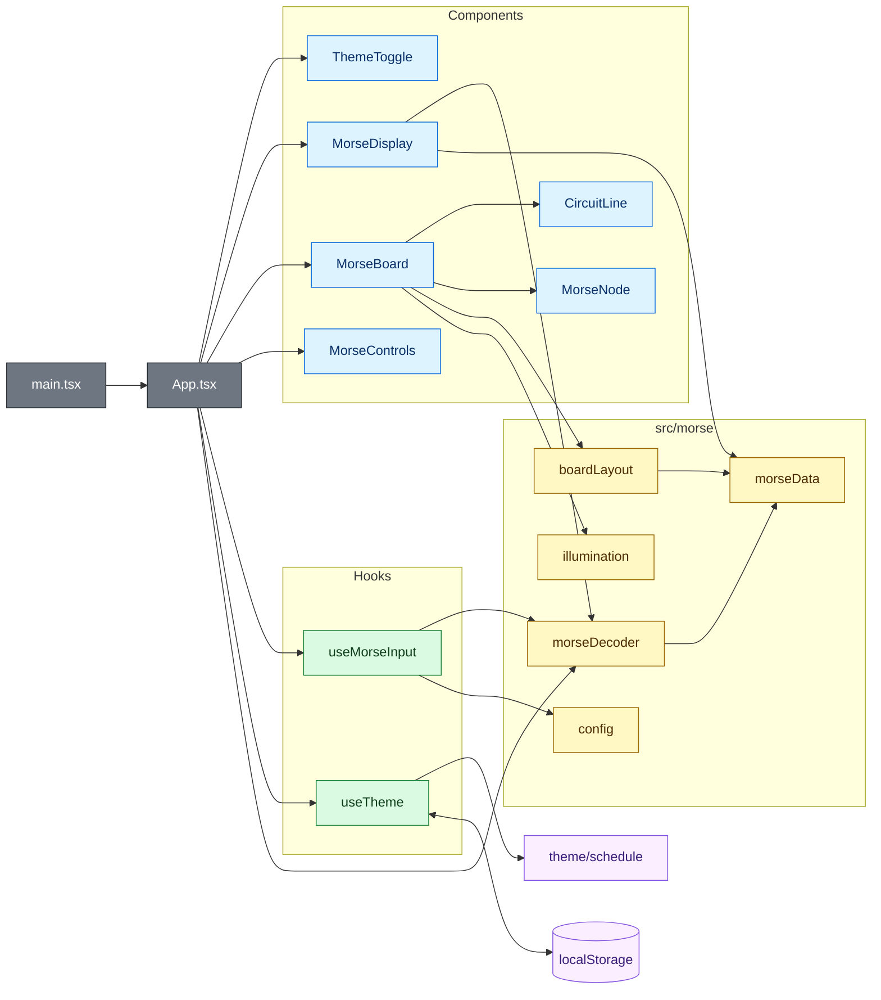

# Morse Code Board

An interactive Morse code decoder built with React, TypeScript and Vite. Enter dots and dashes and watch the signal travel through a circuit-board-style decoding tree until it reaches the matching letter or digit.

## Live Demo

**[🚀 Live Demo](https://aniruddha-25.github.io/morse-code/)**

### How to Access and Use

1. Open the Live Demo link in any modern browser.
2. On mobile, tap the on-screen buttons. On desktop, use the keyboard.
3. Press `Alt` for a dot (`.`) and `Space` for a dash (`-`).
4. Press `Enter` to confirm a character. With an empty sequence, `Enter` inserts a space.
5. Press `Backspace` to correct a mistake.
6. Watch the circuit light up as you enter each symbol.

## Features

- All 26 letters (A–Z) and 10 digits (0–9) in International (ITU) Morse code.
- Circuit-board decoding tree with animated, glowing traces and LED-style pads.
- Keyboard and on-screen (touch) controls.
- Live readout of the current sequence, the matching character and the decoded text.
- Red flash and a short message for invalid input.
- Responsive layout that scales from phones to desktops.
- Light and Dark Mode with automatic switching and a manual override.
- Static site: no backend, no network requests.

## Board Design and Working Principle

Morse code forms a **binary tree**. Every dot or dash moves one step down a branch, and every node on the way is a character (or the start of a longer code). On the board, **dots branch upward (round pads)** and **dashes branch downward (rectangular pads)**, and the signal flows from left to right.

The tree is built once from a single mapping in [src/morse/morseData.ts](src/morse/morseData.ts). The same tree drives decoding and the board layout, so they cannot disagree.

- Letters are 1–4 symbols long. Digits are always 5 symbols long.
- Three nodes carry **no character** and exist only as structure: `··−−` (leads to 2), `−−−·` (leads to 8) and `−−−−` (leads to 9 and 0).

### Diagram 1: Morse code board structure

Green branches are dots (`·`) and blue branches are dashes (`−`). Dashed grey nodes are intermediate nodes with no character. To decode a character, follow the branches from **START**.



## Keyboard and Mobile Controls

| Action | Keyboard | Mobile / on-screen button |
| --- | --- | --- |
| Add a dot (`·`) | `Alt` | **Dot** (round) |
| Add a dash (`−`) | `Space` | **Dash** (rectangular) |
| Confirm the character, or insert a space if the sequence is empty | `Enter` | **Confirm** (↵) |
| Delete the last symbol, or the last character if no sequence is being entered | `Backspace` | **Delete** (⌫) |
| Clear the sequence and output | n/a | **Reset** button in the readout |

Notes:

- Holding a key does not repeat it.
- `Ctrl`, `Meta` and `Alt` combinations (browser shortcuts) are ignored, so they keep working normally.
- When the theme switch has keyboard focus (via `Tab`), `Space` and `Enter` toggle the theme instead of typing Morse.

## Interactive Decoding Process

1. Each symbol you enter moves one step along the tree. The matching pads and traces light up, and the readout shows the letter at the current node.
2. If no character can continue the path (for example `·−−−−−`), the symbol is rejected, the path flashes red for 0.8 s and the valid sequence is kept.
3. `Enter` saves the character to the output and turns the circuit off for the next one.
4. If the sequence is only part of a code (for example `··−−`), `Enter` flashes red and keeps the sequence so you can continue.

**Example: typing `HI`**

| Step | Input | Sequence | Readout | Output |
| --- | --- | --- | --- | --- |
| 1–4 | `Alt` × 4 | `· · · ·` | H | |
| 5 | `Enter` | | | `H` |
| 6–7 | `Alt` × 2 | `· ·` | I | `H` |
| 8 | `Enter` | | | `HI` |

### Diagram 2: Application workflow



## Theme Behavior

- **Automatic:** the theme follows the device's local time. Light Mode runs from **6:00 AM to 5:59 PM** and Dark Mode from **6:00 PM to 5:59 AM**. The app switches at those times without a reload, and re-checks when the tab becomes visible again.
- **Manual override:** the Light/Dark switch in the header changes the theme and saves the choice in `localStorage` under the key `morse-theme`. A saved choice always wins over the automatic schedule.
- To return to automatic mode, clear the `morse-theme` entry in the browser's site data.
- A small inline script in [index.html](index.html) applies the theme before the first paint, so the page never flashes the wrong theme.

## Technology Stack

| Area | Tool |
| --- | --- |
| UI | React 19 |
| Language | TypeScript |
| Build tool | Vite |
| Tests | Vitest |
| Linting | ESLint with typescript-eslint |
| Icons | react-icons (Lucide) |
| Hosting | GitHub Pages via GitHub Actions |

### Diagram 3: Project architecture

Arrows point from a module to the modules it imports or uses.



## Installation and Local Development

Requires Node.js 22.12 or newer (the deploy workflow uses Node.js 26).

```bash
git clone https://github.com/Aniruddha-25/morse-code.git
cd morse-code
npm ci
npm run dev
```

Open the local address printed by Vite (usually `http://localhost:5173/`). In development the app is served from `/`.

## Testing and Production Build

| Command | Purpose |
| --- | --- |
| `npm test` | Run the Vitest test suite once |
| `npm run lint` | Lint the project with ESLint |
| `npm run build` | Type-check and create the production build in `dist/` |
| `npm run preview` | Serve the production build locally |

Production builds use the base path `/morse-code/` (see [vite.config.ts](vite.config.ts)), so open the URL that `npm run preview` prints, including that path.

## GitHub Pages Deployment

The site is deployed by [.github/workflows/deploy.yml](.github/workflows/deploy.yml) using the official GitHub Pages actions.

- **Scheduled:** every day at **12:00 AM IST** (`30 18 * * *` in UTC). GitHub may start scheduled runs a few minutes late. A scheduled run deploys the latest commit on the default branch and is skipped if that commit was already deployed successfully.
- **Manual:** run it any time from **Actions → Deploy to GitHub Pages → Run workflow**. Manual runs always deploy.
- **Not on push:** pushing code or opening pull requests does not deploy.
- Each deployment first runs `npm ci`, `npm run lint`, `npm test -- --run` and `npm run build`. If any step fails, nothing is deployed.

**One-time setup:** in the repository, open **Settings → Pages**, set **Source** to **GitHub Actions**, then run the workflow manually for the first deployment.

## Project Structure

```text
├── .github/workflows/deploy.yml   # GitHub Pages deployment
├── index.html                     # Page shell and pre-paint theme script
├── vite.config.ts                 # Vite config (Pages base path)
└── src/
    ├── main.tsx                   # React entry point
    ├── App.tsx                    # Page layout; connects hooks to components
    ├── components/                # MorseBoard, MorseNode, CircuitLine,
    │                              # MorseDisplay, MorseControls, ThemeToggle
    ├── hooks/
    │   ├── useMorseInput.ts       # Input state, keyboard handling, errors
    │   ├── useTheme.ts            # Theme state, automatic switching, override
    │   └── tests/
    ├── morse/
    │   ├── morseData.ts           # A–Z and 0–9 mapping and the Morse tree
    │   ├── morseDecoder.ts        # Walk the tree for a sequence
    │   ├── boardLayout.ts         # Board geometry derived from the tree
    │   ├── illumination.ts        # Which nodes and traces are lit
    │   ├── config.ts              # Error flash duration
    │   ├── types.ts
    │   └── tests/
    └── theme/
        ├── schedule.ts            # 6 AM / 6 PM schedule
        └── tests/
```
